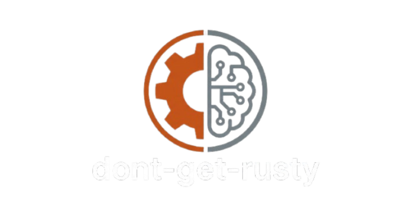

<p align="center">
  
</p>

# dont-get-rusty

A local coding agent whose model-generated code runs only inside a WebAssembly
sandbox. One command drives an OpenAI-compatible local endpoint; the Python
Guest sees a read-only Runtime Image and a read-only Workspace, with no network,
no environment, and no processes. Every durable write is a policy-checked,
audited host tool call.

## Setup

Requires a Rust toolchain (edition 2024).

1. Fetch the pinned Guest assets once (needs network):

   ```sh
   scripts/fetch-assets.sh
   ```

   This downloads the CPython 3.15.2 WASI build (`python.wasm` plus
   `lib/python3.15/`) into the gitignored `assets/`, verifies the archive
   SHA-256, and writes `assets/checksums.txt` with a SHA-256 for every file in
   the image. Startup verifies the whole image against that file (and
   `python.wasm` against its embedded pin) and refuses to run, naming the
   mismatched file and the fetch command, if the image or its checksums are
   missing or corrupt.

2. Point `[llm].base_url` at your local OpenAI-compatible server (Ollama's
   default is `http://localhost:11434/v1`). The default model is
   `qwen3.5:4b`; `qwen2.5-coder:7b` is the documented upgrade for more reliable
   tool calling.

Wasmtime is pinned to **50.0.1**: the WASI preview 1 API and the socket stubs
are version-specific.

Set `DGR_ASSETS=<dir>` to use a Runtime Image outside this repository (the CLI
tests do this; a deployment can keep the image in a read-only location).

## Usage

```sh
cargo run -- "write a script that prints the first 10 primes, run it, and save it"
```

Flags:

| Flag | Meaning |
|---|---|
| `--workspace <DIR>` | Workspace the agent may read and write; overrides `[fs].root` (default `./workspace`, created if missing). |
| `--policy <FILE>` | Policy file to load instead of `./policy.toml` or the built-in defaults. It must exist and must live outside the Workspace. |
| `--yes` | Answer yes to every confirmation: overwrites of pre-existing files and the pause after three consecutive failed Runs. |

A required confirmation in a non-TTY session becomes a denial Observation, so a
pipeline never hangs.

## Web Demo

The same Agent Loop behind a localhost browser page:

```sh
cargo run --features web --bin dont-get-rusty-web
```

It serves `http://127.0.0.1:7878` (loopback only, no authentication, no CORS)
and prints the model and Workspace it is using. `--workspace` and `--policy`
behave exactly as in the CLI, and each Task appends its own session to the same
`.agent/audit.jsonl`. `--port <PORT>` moves the listener.

The page shows every Step, Tool Call, and Observation — including exit codes,
`timed_out`, truncation, and durations — plus a read-only view of the Workspace
and the Audit Log. The two Confirmation points (overwriting a pre-existing
file, continuing after three failed Runs) appear as a modal; an unanswered
question is denied after ten minutes.

Preset buttons produce repeatable sandbox behaviour: an `/etc/passwd` escape
attempt, a 10 s timeout, a 300 MB allocation, and a Workspace read.

Deliberate limits: one Task at a time (a second submission gets `409`), no
cancel button, and no public deployment story — the demo inherits the CLI's
trust model. See `docs/adr/0003-web-demo-scope.md`. The page is plain
HTML/CSS/ES modules embedded in the binary, so there is no npm step; editing
`web/` requires a rebuild.

## Policy

`policy.toml` is host-side only; the model cannot read or modify it (startup
refuses a policy file inside the Workspace). Every value has a default, so a
partial file is valid, and unknown keys are rejected.

| Section | Keys (default) |
|---|---|
| `[sandbox]` | `memory_mb = 256`, `timeout_s = 10`, `max_output_kb = 64`, `network = false` |
| `[fs]` | `root = "./workspace"`, `max_total_mb = 50`, `confirm_overwrite = true` |
| `[agent]` | `max_steps = 25`, `max_failed_runs = 3`, `context_budget_chars = 16000` |
| `[llm]` | `base_url = "http://localhost:11434/v1"`, `model = "qwen3.5:4b"`, `request_timeout_s = 120` |

`[sandbox] network = true` is rejected: v1 grants the Guest no network
capability at all. The quota is checked before each `write_file`; a write that
would exceed it creates and truncates nothing.

## Sandbox guarantees

- The Guest gets exactly two read-only preopens: the Runtime Image at `/` and
  the Workspace at `/workspace`. No environment variables, no network, no
  processes, and no writable paths.
- Guest writes fail with `PermissionError`; `write_file` is the only durable
  write path, and it goes through `cap-std`, which denies `..`, absolute paths,
  and symlinks that leave the Workspace.
- Every Run gets a fresh `Store`. Limits: 10 s wall-clock epoch deadline
  (exit 124, `timed_out`), 256 MB per linear memory (exit 137), 64 KB retained
  per output stream (the rest is drained, counted, and reported with a
  truncation marker). Guest `sys.exit(n)` is `n`; any other trap is exit 1.
- The compiled Guest module is cached under `<cwd>/.agent/cache`, keyed by the
  wasm bytes and the Wasmtime version, so a warm start does not pay the ~1.3 s
  compile. An unusable cache directory is a clear setup error, never a panic.
- The whole Runtime Image is hash-verified at startup from the image's
  `checksums.txt`; a tampered or missing file (including a stdlib file)
  is refused before anything runs.

## Audit

Every Tool Call appends exactly one JSON line to `<cwd>/.agent/audit.jsonl`,
which lives outside the Workspace so neither the Guest nor the model can read
it. An event records the timestamp, session id, Step, tool, a SHA-256 of the
full arguments, the redacted argument prefix, the decision, exit code, output
byte counts, truncation flag, and duration. `code`, `content`, and `stdin` are
replaced by `<omitted: N bytes>` markers, so bodies never reach the log.

`decision`/`denial_reason` are the Policy verdict only. A call the Policy
allowed but that failed on the host (quota, escape, overwrite decline,
malformed arguments, Sandbox setup) stays `allow` and records the host-side
message in the optional `error` field; a Policy denial carries `denial_reason`
and no `error`. A Guest Run is `allow` even when its exit code is non-zero.
Output byte counts are totals produced before truncation.

## Tests

```sh
scripts/fetch-assets.sh          # once, needs network
cargo test --offline             # ~3 minutes; the real CPython Guest runs
cargo test --offline --features web   # adds the Web Demo routes
cargo fmt --check
cargo clippy --all-targets --all-features -- -D warnings
```

The suite includes a consolidated escape suite against the real Guest
(`tests/escape.rs`), an end-to-end CLI test that spawns the binary against a
dependency-free stub OpenAI server on loopback (`tests/e2e.rs`), and the
compiled-module cache tests (`tests/cache.rs`). No test contacts Ollama or any
host beyond `127.0.0.1`.

After the one-time asset fetch (and the initial Cargo dependency download), the
agent works offline: the only network dependency at runtime is your local model
endpoint.
